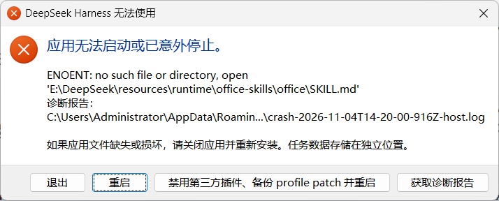

# dsh-guard · DeepSeek Harness 更新后启动弹窗的永久修复

> 作者：[知乎老哥](https://www.zhihu.com/people/svip3)

每次 DSH 自动更新后，启动就弹一个框：

```
DeepSeek Harness 无法使用
应用无法启动或已意外停止。
ENOENT: no such file or directory, open
'E:\DeepSeek\resources\runtime\office-skills\office\SKILL.md'
```

点「重启」还是弹，重装才能活，下一次更新又来一次。

这个仓库给的是**根因 + 自愈守护**，装上之后不用再管。



## 为什么会弹

两件事撞在一起：

1. **官方技能包在启动时裸读文件**
   `resources/app.asar` → `dsh/node_modules/@deepseek-ai/dsh-skill-office/lib/index.js`
   的 `apply()` 对 7 个技能名逐个 `readFileSync(join(assetRoot, name, "SKILL.md"))`，没有 try/catch。
   `assetRoot` = `resources/runtime/office-skills`。文件不在 = 抛 ENOENT = 宿主 fatal = 弹框。

2. **安装器在原地覆盖，存在空窗期**
   `%LOCALAPPDATA%\@deepseek-aidsh-desktop-updater\installer-logs\directory-failure-*.log` 里能直接看到：

   ```
   Operation: MoveFileExW
   Windows error: 5 (拒绝访问。)
   Source: e:\DeepSeek
   Destination: e:\DeepSeek.old-{GUID}
   ```

   旧目录改名失败（有进程占着），安装器退化成原地覆盖：先删 `resources/runtime`，再解压。
   如果这段时间应用被拉起（更新完自动启动、或用户手快双击），runtime 还没落盘 → 正好命中 1）。

所以这不是「偶发」，是**每次更新都可能发生**，取决于窗口期里应用有没有起来。

## 怎么修

`dsh_guard.pyw` 常驻（SYSTEM 计划任务），每 0.4 秒做四件事：

| 动作 | 条件 | 结果 |
|---|---|---|
| 补齐技能包 | 任一 `SKILL.md` 缺失 | 0.4 秒内从 stash 复制回去，日志 `heal restored N file(s)` |
| 清理残留 | 主程序没在跑 | 杀掉所有 image path 以 `resources` 所在盘符开头的旧进程，避免安装器再次 error 5 |
| 让路安装器 | 检测到 `installer.exe` / `deepseek-harness-*.exe` | 立即清一遍旧进程（120 秒内只做一次，不会误杀装完新起的实例） |
| 刷新 stash | `app.asar` 大小或 mtime 变化 | 从新版 asar 重新抽取 7 个技能到 stash，升级不丢内容 |

配套：

- `install.ps1`：从注册表找安装位置 → 找 pythonw（优先用 DSH 自带的）→ 复制到 `C:\ProgramData\dsh-guard\` → 备份/抽取 stash → 注册计划任务 `dsh-guard`（SYSTEM / 最高权限 / 开机+登录 / 崩溃自动重启 99 次）。
- `uninstall.ps1`：停任务删任务，`-Purge` 连 `C:\ProgramData\dsh-guard` 一起删。
- `tools\build_stash.py`：不依赖 Electron，直接解析 asar 头（`jlen` + `base=12+json_len+4`），把 7 个技能抽出来；`app.asar.unpacked` 里的项也能处理。

## 安装

管理员 PowerShell：

```powershell
git clone https://github.com/Buir5/dsh-guard.git C:\AI\_scratch\dsh-guard
powershell -ExecutionPolicy Bypass -File C:\AI\_scratch\dsh-guard\install.ps1
```

装完立刻生效，不用重启 DSH。验证：

```powershell
Get-ScheduledTask dsh-guard | Select-Object TaskName,State
Get-Content C:\ProgramData\dsh-guard\guard.log -Tail 20
```

想手动测一次自愈：把 `resources\runtime\office-skills` 改名，两秒内会被补回来。

## 卸载

```powershell
powershell -ExecutionPolicy Bypass -File install.ps1 -Uninstall
```

## 我是怎么定位的（完整过程）

### 时间线（2026-11-04）

| 时间 | 事件 |
|---|---|
| 23:17:14 | 第一次弹窗，`crash-2026-11-04T14-17-14-host.log` |
| 23:18:24 / 23:19:05 / 23:19:26 / 23:20:00 | 连续复现，每次点「重启」都再弹 |
| 23:20:25 | 第六份崩溃日志，2,676 B，内容完全一致 |
| 23:21:01 | `resources\runtime\office-skills` 的 CreationTime（更新收尾才落盘） |

六份日志、同一个栈、同一个缺失路径 —— 说明不是随机故障，是**确定的时序竞争**。

### 证据 1：崩溃栈（docs/crash-host.log）

```
DesktopHostFatalError
  at file:///E:/DeepSeek/resources/app.asar/lib/main.js:10026:49
  at readFileSync
  at E:/DeepSeek/resources/app.asar/dsh/node_modules/@deepseek-ai/dsh-skill-office/lib/index.js:64:38
  at new apply (…dsh-skill-office/lib/index.js:61:33)
```

宿主在启动阶段同步加载技能包，读文件抛 ENOENT → 直接 fatal，没有任何降级路径。

### 证据 2：安装器日志（docs/installer-directory-failure.log）

```
Operation: MoveFileExW
Windows error: 5 (拒绝访问。)
Source: e:\DeepSeek
Destination: e:\DeepSeek.old-{3905A249-...}
Restoration error: 0
Time: 2026-10-30 10:46:04
```

旧目录改名失败（有进程占着句柄），安装器退化成**原地覆盖**：先删 `resources\runtime`，再逐项解压。这个空窗期就是崩溃窗口。10-24 也有一条同样的日志，说明是常态而非偶发。

### 推理链

1. **为什么偏偏是 SKILL.md？** 解开 asar 读源码：`dsh-desktop-host` 里 `assetRoot = join(dirname(config.source), "office-skills")`，而 `config.source` = `process.resourcesPath\runtime\primary-runtime`，所以技能目录固定指向 `runtime\office-skills`。
2. **为什么一个文件缺失就崩？** `dsh-skill-office` 的 `apply(ctx, config)` 对 7 个技能名逐个 `readFileSync(join(assetRoot, name, "SKILL.md"))`，无 try/catch，第一个缺失即抛。
3. **为什么每次更新都可能踩中？** 安装器 error 5 → 原地覆盖 → runtime 先空后满；应用在这个窗口被拉起（更新完自动启动、或用户手快双击）就必崩。
4. **排除项**：文件权限（SYSTEM 可正常读写）、磁盘损坏（重新解压 20,519 文件全通过）、第三方插件冲突（禁用全部插件后仍弹，崩点在宿主内部）、asar 损坏（能正常列出目录树）。

### 为什么不直接改 JS 打补丁

- 补丁写进 `app.asar`：下次更新整包替换，补丁消失。
- 补丁写进解开目录 `resources\app`：需要把 `app.asar` 改名让 Electron 走目录，更新同样会重建 asar。
- 结论：**任何贴在包里的补丁都活不过一次更新**。所以把修复放在文件系统层，与版本解耦。

### 设计取舍

| 选择 | 原因 |
|---|---|
| 0.4 秒轮询，不用计划任务 | 弹窗发生在启动瞬间，分钟级定时来不及 |
| stash 放 `C:\ProgramData\dsh-guard` | 不受用户 profile 清理、漫游影响 |
| 安装器存在时只清理一次（120 s 窗口） | 避免把安装完自动启动的新实例误杀 |
| 手写 asar 解析（`base = 12 + json_len + 4`） | 不依赖 Electron / node，pythonw 直接跑 |
| 只动 `runtime\office-skills` | 不碰用户数据、不碰配置，可逆 |

### 验证

把技能目录改名，两秒内被补回：

```
> ren E:\DeepSeek\resources\runtime\office-skills office-skills.bak
> type C:\ProgramData\dsh-guard\guard.log
2026-11-04 23:26:27 heal restored 8 file(s), missing=office,office-docx,office-pptx,office-xlsx,office-render,office-recalculate,office-export-pdf
```

同时把 `app.asar` 改名/替换后，stash 会自动刷新：

```
2026-11-04 23:31:02 stash refreshed from asar: 7 file(s)
```
## FAQ

**会不会影响更新？** 不会。它只在安装器运行期间清理旧进程，更新照常进行。

**会占多少资源？** 0.4 秒一轮的目录存在性检查，CPU 占用不到 0.1%，内存约 12 MB。

**为什么不用计划任务定时补文件？** 弹窗发生在启动瞬间，分钟级任务来不及；必须常驻轮询。

**卸载后还会弹吗？** 会，等下一次更新窗口期踩中。

---

## English

**Problem.** After every auto-update, DeepSeek Harness dies at boot with
`ENOENT ... resources/runtime/office-skills/office/SKILL.md`, because the bundled
`dsh-skill-office` plugin `readFileSync`s seven SKILL.md files with no error handling,
while the updater wipes `resources/runtime` and re-extracts in place (its
`MoveFileExW` rename fails with Windows error 5 when processes hold the folder).

**Fix.** `dsh_guard.pyw` runs as a SYSTEM scheduled task and polls every 0.4 s:
restores any missing skill file from a local stash, terminates stale processes under the
install root while the app is not running, clears them once when an installer appears,
and refreshes the stash whenever `app.asar` changes.

**Install.** `powershell -ExecutionPolicy Bypass -File install.ps1` (admin).
**Uninstall.** add `-Uninstall`.

**How it was diagnosed.** Six identical crash logs (23:17–23:20) all end in the same
`readFileSync` inside `dsh-skill-office/lib/index.js:64`; the updater log shows
`MoveFileExW / Windows error: 5` when renaming `e:\DeepSeek`, so the installer falls back
to in-place overwrite and empties `resources\runtime` first. The guard sits at the
filesystem layer because any patch inside `app.asar` or `resources\app` is erased by the
next update. Raw evidence: [`docs/crash-host.log`](docs/crash-host.log),
[`docs/installer-directory-failure.log`](docs/installer-directory-failure.log),
[`docs/guard.log.sample.txt`](docs/guard.log.sample.txt).
MIT License.

---

> **🧭 收徒 · 我靠这套路子吃饭，你也可以**
> 遇到问题先别急着重装，先看日志——九成的「玄学崩溃」都能定位到具体一行。
> 想学这门手艺（逆向、脚本、自动化、把重复劳动交给机器），看这里：
> **[👉 收徒说明（知乎）](https://zhuanlan.zhihu.com/p/54351262)**